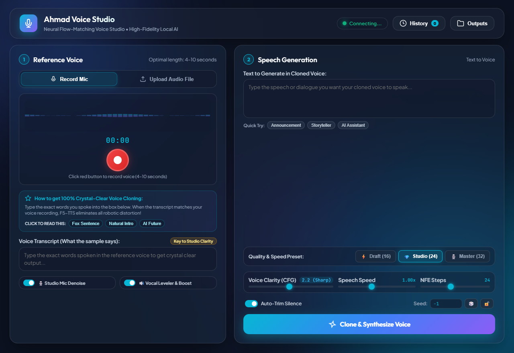
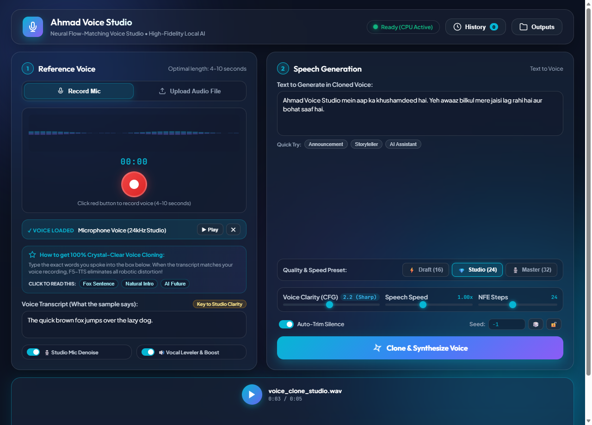

# 🎙️ Ahmad Voice Studio — Neural Voice Cloning & Synthesis

A standalone Windows desktop application with a modern glassmorphic interface powered by **PyWebView**, dynamic audio normalization, real-time waveform visualizer, and CPU-accelerated **F5-TTS Flow Matching**.

<div align="center">
  
  <p><em>Modern glassmorphic interface with live waveform recording, clarity guide, and instant parameter tuning.</em></p>
</div>

<br/>

<div align="center">
  
  <p><em>Studio workflow in action: Reference voice loaded, Roman Urdu synthesis, and real-time waveform playback.</em></p>
</div>

---

## 🌟 Key Features

* **Desktop Native UI**: Premium glassmorphic interface built with Vanilla CSS, modern typography, and ambient lighting.
* **Instant Cancel Support**: Pre-forward PyTorch hook allows instantaneous cancellation during any diffusion/ODE step.
* **Voice Clarity & CFG Controls**: Dynamic Guidance Scale slider (`1.0` to `3.5`) and Quality Presets (`⚡ Draft 16`, `💎 Studio 24`, `🎙️ Master 32`).
* **Studio Audio Normalization**: Automated 24kHz mono PCM conversion with FFmpeg Dynamic Audio Normalizer (`dynaudnorm`), highpass, and lowpass vocal filtering.
* **History & Replay Drawer**: Built-in slide-over drawer to replay, download, or delete past voice clone creations.
* **CPU Optimized**: Multi-threaded flow-matching (`torch.set_num_threads(4)`) for smooth offline execution without a dedicated GPU.
* **Tensor Alignment Fix**: Resolved DiT cache mismatch when switching sequence lengths or generating in sequential batches.

---

## 🚀 Quick Launch (Desktop App)

To start the desktop application:
```bat
cd VoiceStudio
run.bat
```
Or run the included shortcut creator:
```powershell
powershell -ExecutionPolicy Bypass -File VoiceStudio\create_shortcut.ps1
```

---

## 🔬 Core Engine: F5-TTS (CPU Inference)

### About This Fork and Key Changes

This version includes specific fixes to enable stable CPU inference:
- **Code Update:** The inference script (`src/f5_tts/infer/utils_infer.py`) was modified to prevent a crash on startup (`AttributeError: module 'torch' has no attribute 'xpu'`) when using a CPU-only PyTorch installation.
- **Dependency Update:** The project's dependency file (`pyproject.toml`) was updated to resolve a low-level bug in newer PyTorch versions that caused an `IndexError` during audio transcription on CPU.
  - PyTorch is now pinned to a known stable version: `torch==2.1.2`
  - The GPU-only package `bitsandbytes` is no longer installed, preventing installation failures

These changes ensure that anyone can clone this repository and run it on a standard CPU without encountering the original errors.

---

[](https://github.com/SWivid/F5-TTS)
[](https://arxiv.org/abs/2410.06885)
[](https://swivid.github.io/F5-TTS/)
[](https://huggingface.co/spaces/mrfakename/E2-F5-TTS)
[](https://modelscope.cn/studios/modelscope/E2-F5-TTS)
[](https://x-lance.sjtu.edu.cn/)
[](https://www.pcl.ac.cn)

---

**F5-TTS**: Diffusion Transformer with ConvNeXt V2, faster training and inference  
**E2 TTS**: Flat-UNet Transformer, closest reproduction from [paper](https://arxiv.org/abs/2406.18009)  
**Sway Sampling**: Inference-time flow step sampling strategy, greatly improves performance

### Thanks to all the contributors!

---

## Quick Start (Windows)

### 🔧 Installation

If you have [Anaconda](https://www.anaconda.com/) or [Miniconda](https://docs.conda.io/en/latest/miniconda.html) installed and `conda` is available in your terminal:

1. Download and extract this repository to `C:\F5-TTS-CPU_ONLY`
2. Open **Anaconda Prompt** or a Conda-enabled terminal
3. Run:

```bat
install.bat
```

This script will:
- Create a new Conda environment `F5-TTS-CPU_ONLY`
- Activate the environment
- Install the project in editable mode

---

### ▶️ Launch the App

Once installed, you can start the Gradio app by running:

```bat
launch.bat
```

This script will:
- Activate the correct environment
- Launch the Gradio-based TTS interface

---

## Manual Installation (if not using install.bat)

```bash
# Create conda environment
conda create -n F5-TTS-CPU_ONLY python=3.10
conda activate F5-TTS-CPU_ONLY

# Navigate to the folder
cd C:\F5-TTS-CPU_ONLY

# Install the project
pip install -e .
```

---

## Inference (Gradio or CLI)

### 1. Gradio App

```bash
f5-tts_infer-gradio

# Optional flags:
f5-tts_infer-gradio --port 7860 --host 0.0.0.0
f5-tts_infer-gradio --share
```

### 2. CLI Inference

```bash
# Run with custom input
f5-tts_infer-cli --model F5TTS_v1_Base \
--ref_audio "prompt.wav" \
--ref_text "transcription of reference audio" \
--gen_text "Text you want the TTS model to generate."

# Use default config
f5-tts_infer-cli

# With custom TOML
f5-tts_infer-cli -c custom.toml

# Multi-voice/story config
f5-tts_infer-cli -c src/f5_tts/infer/examples/multi/story.toml
```

---

## Training

```bash
# Web UI-based fine-tuning
f5-tts_finetune-gradio
```

Or refer to the training guide for Accelerate-based workflows.

---

## Development & Code Quality

Use `pre-commit` to automatically format and lint code:

```bash
pip install pre-commit
pre-commit install
pre-commit run --all-files
```

---

## Acknowledgements

- E2-TTS brilliant work, simple and effective  
- Emilia, WenetSpeech4TTS, LibriTTS, LJSpeech valuable datasets  
- lucidrains initial CFM structure with also bfs18 for discussion  
- SD3 & Hugging Face diffusers DiT and MMDiT code structure  
- torchdiffeq as ODE solver, Vocos and BigVGAN as vocoder  
- FunASR, faster-whisper, UniSpeech, SpeechMOS for evaluation tools  
- ctc-forced-aligner for speech edit test  
- mrfakename HuggingFace Space demo  
- f5-tts-mlx implementation with MLX framework by Lucas Newman  
- F5-TTS-ONNX ONNX Runtime version by DakeQQ  
- Yuekai Zhang Triton and TensorRT-LLM support  

---

## Citation

If our work and codebase is useful for you, please cite:

```bibtex
@article{chen-etal-2024-f5tts,
  title={F5-TTS: A Fairytaler that Fakes Fluent and Faithful Speech with Flow Matching},
  author={Yushen Chen and Zhikang Niu and Ziyang Ma and Keqi Deng and Chunhui Wang and Jian Zhao and Kai Yu and Xie Chen},
  journal={arXiv preprint arXiv:2410.06885},
  year={2024},
}
```

---

## License

Our code is released under the MIT License.  
The pre-trained models are licensed under the CC-BY-NC license due to the training data (Emilia), which is an in-the-wild dataset.  
Sorry for any inconvenience this m
